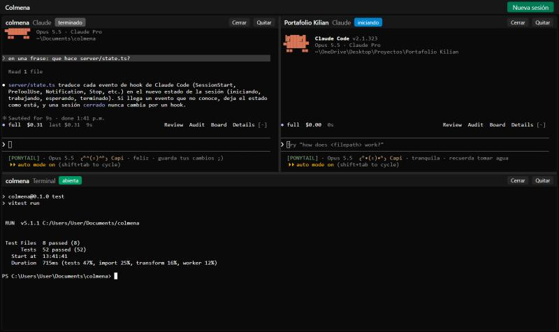

# Colmena

[](https://github.com/kilianvega-dev/colmena/actions/workflows/ci.yml)

Un panel local para trabajar con varias sesiones de Claude Code a la vez. Cada sesión vive en su propio panel, con su carpeta, y Colmena te muestra cuál está **trabajando**, cuál **te está esperando** y cuál **terminó**. Si una se detiene a preguntarte algo, te avisa.



## Por qué existe

Con dos o tres sesiones de Claude abiertas en terminales distintas es fácil perder de vista cuál está esperando tu respuesta. Colmena las junta en una sola página y saca el estado de cada una de los eventos oficiales de Claude Code (hooks), no de leer el texto de la terminal.

## Qué hace

- **Paneles en cuadrícula** con sesiones de Claude Code o terminales normales (PowerShell), con divisiones que puedes arrastrar.
- **Estado en vivo** de cada sesión de Claude: `iniciando`, `trabajando`, `esperando`, `terminado`, `cerrado`.
- **Avisos** cuando una sesión pasa a `esperando`: sonido corto, notificación del navegador, panel resaltado y la cuenta en el título de la pestaña, por ejemplo `(2) Colmena`.
- **Nada se pierde al recargar**: las terminales viven en el servidor, y al volver a abrir la pestaña ves lo último que mostró cada una.
- **Reanudar** después de reiniciar: Colmena recuerda tus sesiones y las retoma con `claude --resume`.

## Requisitos

- Windows 10 u 11 (Mac y Linux aún no están probados).
- Node 24 o superior.
- [Claude Code](https://docs.claude.com/en/docs/claude-code) instalado y en el PATH (o su ruta en la variable `COLMENA_CLAUDE`).

## Uso

```powershell
npx claude-colmena
```

Abre http://127.0.0.1:4777. Con **Nueva sesión** eliges Claude o Terminal y una carpeta, ya sea de las recientes o pegando la ruta. El puerto se cambia con la variable `COLMENA_PORT`.

## Cómo funciona

```
navegador (React + xterm.js)
      │  WebSocket
servidor Node (node-pty)  ◄──── POST /hook ──── hook-relay.cjs
      │                                              ▲
      └── claude --session-id <id> --settings hooks.json
```

- Cada sesión de Claude se lanza con `--settings` apuntando a un archivo de hooks propio de Colmena. Esos hooks ejecutan `hook-relay.cjs`, que manda el evento al servidor local.
- **No se toca `~/.claude/settings.json`** ni ninguna configuración global. Los hooks solo existen en las sesiones que abre Colmena, así que tus otras sesiones de Claude Code no se enteran.
- El estado y las carpetas recientes se guardan en `%APPDATA%\colmena\`.

## Seguridad

- El servidor escucha **solo en `127.0.0.1`**. No hay autenticación, así que no lo expongas a la red.
- Rechaza peticiones cuyo `Host` u `Origin` no sean los de Colmena, para que ninguna página web abierta en tu navegador pueda conectarse a tus terminales (también bloquea el DNS rebinding).
- Los eventos de los hooks exigen un token aleatorio que se genera en cada arranque.

## Desarrollo

```powershell
npm install
npm start       # desde el código, sin npm
npm run dev     # servidor + Vite en http://localhost:5173
npm test        # pruebas con Vitest
```

En `npm run dev`, cada reinicio de `node --watch` corta el servidor sin pasar por el apagado limpio, y las terminales abiertas pueden quedar vivas. Para uso diario usa `npm start`.

El diseño y el plan de la v1 están en [`docs/superpowers/`](docs/superpowers/).

## Licencia

[MIT](LICENSE)
